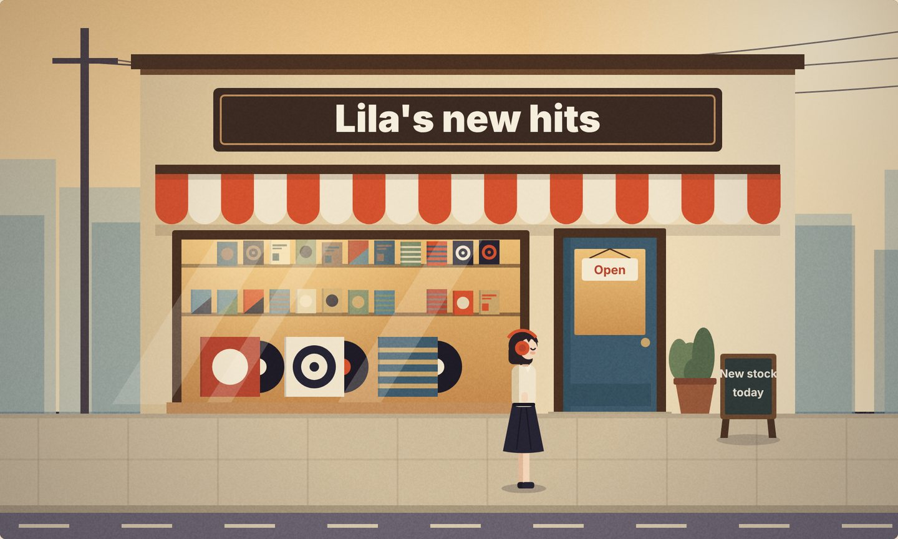
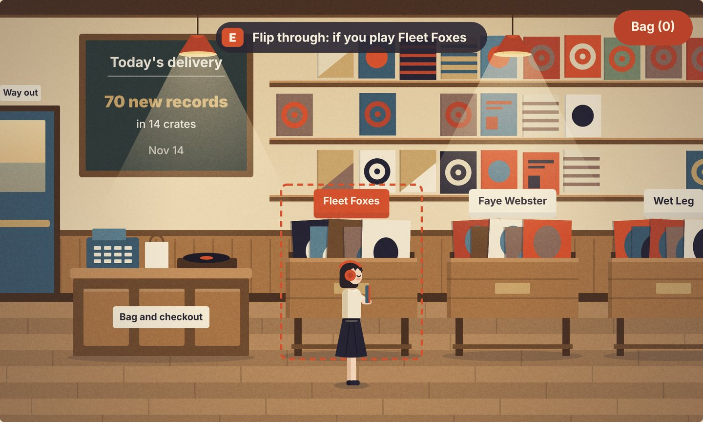
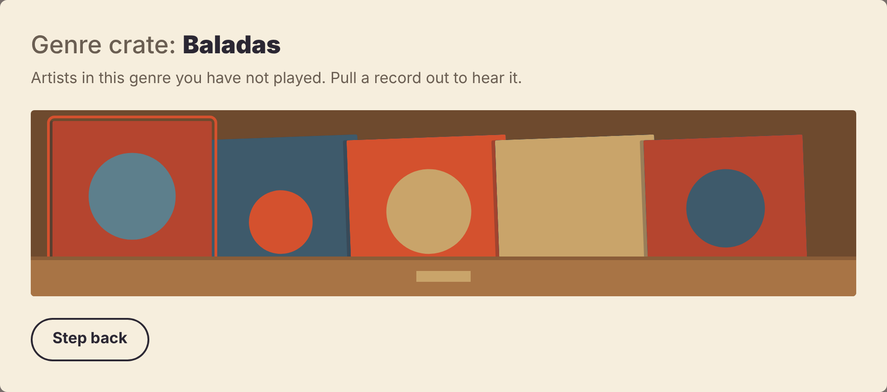
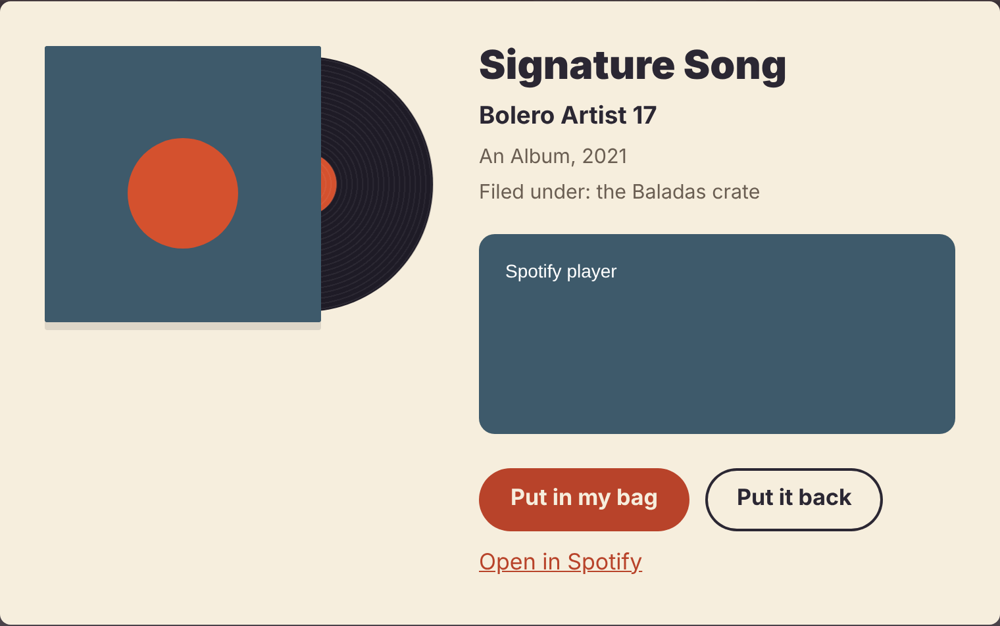

# Lila's new hits

A tiny walk-around record shop that stocks itself with music you have never played. It reads your Spotify listening history, finds similar artists through Last.fm, and fills crates with one song from each new artist. Walk in, flip through a crate, give a record a listen, and save the ones you like to a Spotify playlist.





## What it does

- **A new delivery every day.** Ten crates are built from artists you already play ("If you play Fleet Foxes"), plus four genre crates: Sounds like Daft Punk, Oldies, Baladas, and Latin/Afro House. Each crate holds five records.
- **Only artists you haven't heard.** Anyone in your top artists, top tracks, or recent plays is skipped, and artists the shop has already shown you don't come back unless you ask.
- **A listening station.** Pull a record out of a crate to see its cover, album, and year, and play it with Spotify's player.
- **Checkout to Spotify.** Put records in your bag, then save them to a new private playlist or add them to one of your own playlists. Songs already in that playlist are skipped.
- **Play it like a game or skip the walking.** Use the arrow keys or click to walk. Every crate is also one click away in the links under the shop.





*Screenshots use sample data.*

## What you need

- A Mac with Python 3. No extra packages are needed. It also runs on Windows or Linux with `python3 lilas_new_hits.py`.
- **Spotify Premium.** Spotify's developer tools have required it since February 2026. A Student plan works.
- **Your own Spotify developer app** (free):
  1. Log in at [developer.spotify.com](https://developer.spotify.com) and open the Dashboard.
  2. Create an app. Set the redirect URI to exactly `http://127.0.0.1:8080/callback`, tick **Web API**, and save.
  3. Copy the **Client ID**. You never need the Client secret.
- **A free Last.fm API key** from [last.fm/api/account/create](https://www.last.fm/api/account/create). The app asks for it the first time you open it.

## Setup

1. Open `lilas_new_hits.py` in a text editor, search for `const CLIENT_ID`, and replace the value in quotes with your own Client ID. (The one in the file belongs to the original author's app. Spotify only lets up to 5 approved accounts use an app, so it will not work for you.)
2. On a Mac, open Terminal, type `python3 ` (with a space), drag the file into the window, type ` --install`, and press Enter. This puts a double-clickable **Lila's new hits** on your Desktop. Your Mac makes this copy itself, so you won't get the "Apple could not verify" warning.
3. Double-click **Lila's new hits**. The shop opens in your browser. Keep the small Terminal window open while you use it, and close it when you're done.
4. The first time, connect Spotify and paste your Last.fm key. Then walk through the door.

## Make it yours

The genre crates are a short list near the top of the page's script. Search for `const GENRES`. Each crate takes Last.fm genre tags (the words listeners attach to artists, like `"french house"` or `"bolero"`) and, optionally, artists to find similar sounds for:

```js
{ key: 'baladas', label: 'Baladas', tags: ['balada', 'bolero', 'balada romantica'], like: ['José José'] },
```

Want your own version from scratch, with your own name, colors, and genres? [PROMPT.md](PROMPT.md) is a ready-to-paste prompt for an AI assistant like Claude.

## Good to know

- **It runs only on your computer.** The app is a small local server on `127.0.0.1:8080`. Your Spotify sign-in and Last.fm key stay in your browser, and nothing is sent anywhere except to Spotify and Last.fm.
- **Spotify changes its rules.** Spotify restricted its developer API in 2024 and again in 2026, which is why recommendations come from Last.fm. If something stops working, check Spotify's Web API changelog.
- **Deliveries take a minute.** A full delivery makes about 100 Spotify searches. If Spotify slows things down, the shop waits and retries, and keeps whatever crates already arrived.

## Built with

Plain Python, HTML, CSS, and JavaScript in a single file, with the [Spotify Web API](https://developer.spotify.com/documentation/web-api), the [Last.fm API](https://www.last.fm/api), and the [Zen Maru Gothic](https://fonts.google.com/specimen/Zen+Maru+Gothic) typeface. Made with help from Claude.
